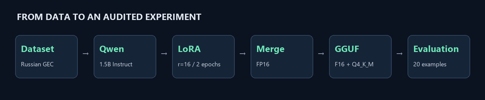
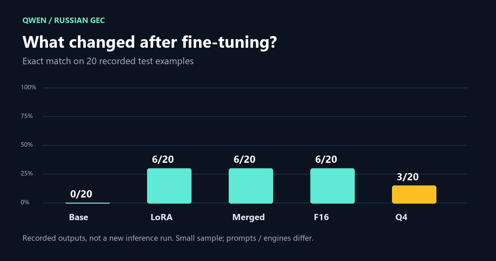

# Qwen Russian Grammar Correction

**Qwen2.5-1.5B · LoRA · Soup CLI · GGUF**  
Эксперимент по исправлению русского текста — от обучения до проверки экспортированной модели.

[Hugging Face](https://huggingface.co/Prosto19/qwen-russian-gec-lora) · [Notebook](notebooks/soup_qwen.ipynb) · [Конфигурация](configs/soup.yaml) · [English report](reports/Soup_AI_Engineer_Report_Final..pdf) · [Отчёт на русском](reports/Soup_AI_Engineer_Report_RU.pdf)

## 🇷🇺 О проекте

Дообучение `Qwen/Qwen2.5-1.5B-Instruct` на русском GEC-датасете через Soup: LoRA, объединение весов, экспорт F16 / Q4_K_M GGUF и сравнение сохранённых ответов.

**Обучение:** Tesla T4 · 2 эпохи · 338 шагов · LoRA r=16, alpha=32.  
**Файл Q4:** 986 045 248 байт — 940,4 МиБ (986,0 МБ).  
**Hugging Face:** [Prosto19/qwen-russian-gec-lora](https://huggingface.co/Prosto19/qwen-russian-gec-lora). Репозиторий создан; файл GGUF ещё не загружен. [Подготовленная Model Card](huggingface/README.md).

## Результаты

| Base | LoRA | Merged FP16 | F16 GGUF | Q4 GGUF |
|---:|---:|---:|---:|---:|
| 0/20 | 6/20 | 6/20 | 6/20 | 3/20 |

**DON'T SHIP:** это экспериментальная модель, не готовый корректор. Exact Match — совпадение с эталоном после `.strip()`, а не оценка смысла. Всего 20 примеров; формулировки запросов и движки между этапами различаются. Независимый повторный запуск модели здесь не заявляется.

### Реальные примеры

| ID | Input | LoRA | Q4 GGUF |
|---|---|---|---|
| 35 | Передача данных с микроконтроллера на сервер может быть реализована двумя способами:. | Передача данных с микроконтроллера на сервер может быть реализована двумя способами: | Передача данных с микроконтроллера на сервер может быть реализована двумя способами: |
| 139 | Истцы требуют измени некоторые правила футбола. | Истцы требуют изменить некоторые правила футбола. | Истцы требуют изменения некоторых правил футбола. |
| 129 | Местонахождение картины так и остаться неизвестным. | Местонахождение картины так и осталось неизвестным. | Местонахождение картины так и остается неизвестным. |

Выбраны один успех Q4 и два несовпадения Q4 с эталоном при точном ответе LoRA; это иллюстрации, а не случайная выборка. Источник: [сохранённые результаты](results/q4_gec_results.json), `test_index` указан слева.

Проверить метрики без GPU и дополнительных библиотек: `python scripts/check_results.py`. Подробности обучения, памяти и ограничений — в PDF-отчётах выше.

---

## 🇬🇧 English

A Russian grammatical error correction case study using Qwen2.5-1.5B-Instruct, Soup CLI and LoRA. The pipeline covers training, merging, F16 / Q4_K_M GGUF export and an audit of recorded outputs.

**Training:** Tesla T4, 2 epochs, 338 steps, LoRA r=16 / alpha=32. **Q4 file:** 940.4 MiB. [Hugging Face repository](https://huggingface.co/Prosto19/qwen-russian-gec-lora) is created; the GGUF upload is still pending; the [model card draft](huggingface/README.md) documents the intended release.

The chart reports **0/20 → 6/20 → 6/20 → 6/20 → 3/20** exact matches for Base, LoRA, Merged, F16 and Q4. **DON'T SHIP:** twenty examples do not establish general accuracy. Prompt wording and inference engines differ across stages; valid alternative corrections can fail exact match. No fresh inference run is claimed.

The examples above show one Q4 exact match and two Q4 mismatches where LoRA matched the reference. Run `python scripts/check_results.py` for a dependency-free archival check. See the [English technical report](reports/Soup_AI_Engineer_Report_Final..pdf) for the full experiment and limitations.
