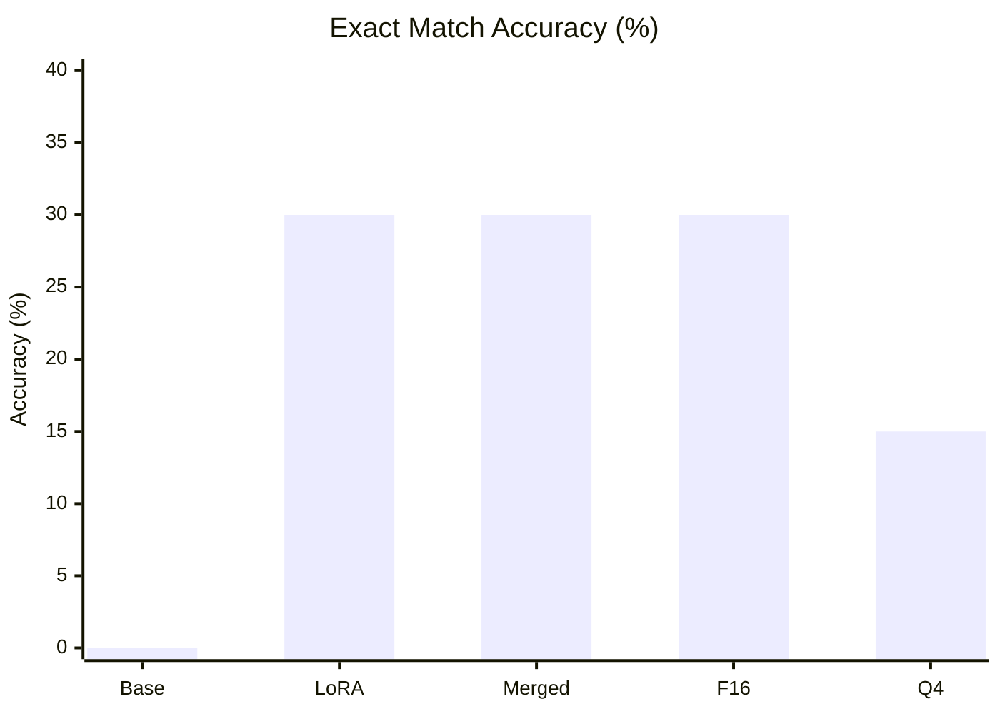

# Qwen Russian Grammar Correction

**AI/ML Project | Qwen2.5-1.5B · LoRA · Soup CLI**

## 🇷🇺 О проекте

Экспериментальный AI/ML-проект по дообучению Qwen2.5-1.5B-Instruct для исправления грамматических и орфографических ошибок в русском языке.

Проект включает LoRA-дообучение, объединение весов, квантование GGUF и сравнительное тестирование.

**Технологии:** Python · PyTorch · Transformers · PEFT · LoRA · Soup CLI · llama.cpp

## Результаты эксперимента

*Результаты предварительные: тестирование проводилось на 20 примерах.*

**Итоговое решение: DON'T SHIP**

Дообучение улучшило результаты, однако после 4-битного квантования количество точных совпадений снизилось. Модель пока не готова к использованию в реальных продуктах.

## Model

- **Base:** Qwen2.5-1.5B-Instruct
- **Training:** 338 шагов, 2 эпохи
- **Quantization:** Q4_K_M (GGUF)
- **Model size:** ~940 MB

## Project Files

- [Training Notebook](notebooks/soup_qwen.ipynb)
- [Verification Script](scripts/verify_soup.py)
- [Soup Configuration](configs/soup.yaml)
- [English Technical Report](reports/Soup_AI_Engineer_Report_Final.pdf)
- [Russian Technical Report](reports/Soup_AI_Engineer_Report_RU.pdf)

**Подробнее о проекте:** полное описание обучения, анализ использования видеопамяти, проверка LoRA, обнаруженные ошибки и обоснование итогового решения представлены в технических отчётах выше. В репозитории также доступны код, конфигурация, логи и результаты экспериментов.

---

# 🇬🇧 English Version

**AI/ML Project | Qwen2.5-1.5B · LoRA · Soup CLI**

An experimental AI/ML project focused on fine-tuning Qwen2.5-1.5B-Instruct for Russian grammar and spelling correction.

The project covers LoRA fine-tuning, model merging, GGUF quantization, and evaluation.

**Tech Stack:** Python · PyTorch · Transformers · PEFT · LoRA · Soup CLI · llama.cpp

## Results

The chart above shows exact-match accuracy across five model configurations.

*Evaluation was conducted on 20 examples. Results are preliminary.*

**Final verdict: DON'T SHIP**

Fine-tuning improved results on the selected examples, but 4-bit quantization reduced the exact-match score. The model is not ready for production deployment.

## Model

- **Base:** Qwen2.5-1.5B-Instruct
- **Training:** 338 steps, 2 epochs
- **Quantization:** Q4_K_M (GGUF)
- **Model size:** ~940 MB

**More information:** Detailed training results, GPU memory analysis, LoRA verification, encountered issues, and the final decision are documented in the technical reports linked in **Project Files** above. The repository also contains the experiment notebook, configuration, logs, and evaluation results.